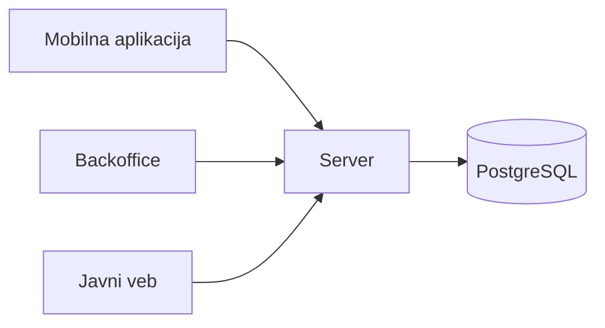

# Reboot – servis računara

Sistem za prijem i praćenje popravki računara u servisu. Klijenti preko mobilne aplikacije prijavljuju uređaj za popravku, prate radni nalog kroz dijagnostiku i popravku i odobravaju ponudu, i kada nemaju signal. Serviseri i šef servisa u backoffice aplikaciji preuzimaju naloge, prave ponude i vode stanje rezervnih delova, a javni veb prikazuje cenovnik, usluge i radno vreme servisa.

## Tim

| Ime i prezime | Broj indeksa | GitHub nalog |
| --- | --- | --- |
| Vojin Prljević | SI 74/24 | [VPrljevic](https://github.com/VPrljevic) |

Projekat radim samostalno.

## Zahtevi za temu

1. **Uloge.** Klijent vidi i menja samo svoje radne naloge (prijava uređaja, odgovor na ponudu). Serviser vidi sve naloge, preuzima ih i menja im stanje, a šef servisa uz to dodeljuje naloge serviserima i vodi stanje rezervnih delova.
2. **Stanja.** Glavni pojam je radni nalog, koji prolazi kroz stanja: primljen, dijagnostika, čeka odobrenje, u popravci, spreman za preuzimanje i preuzet. Nalog može da završi i kao otkazan ili kao odbijena ponuda.
3. **Pravila.** Klijent mora da odgovori na ponudu u roku od 48 sati, a serviser može imati najviše 5 aktivnih naloga. Dva servisera ne mogu istovremeno preuzeti isti nalog niti rezervisati poslednji komad istog dela sa stanja; o tome konačno odlučuje server, jer zavisi od podataka drugih korisnika.
4. **Rad bez mreže.** Klijent može da odobri ili odbije ponudu bez signala, a odluka se šalje serveru kada se veza vrati. Ako ponuda u međuvremenu istekne, server odbija zakasnelu odluku i klijent to vidi u aplikaciji.
5. **Posao za osoblje.** Osoblje radi sa svim nalozima servisa odjednom: tabla naloga po fazama, dodela servisera i pregled stanja delova, što zahteva veći ekran.
6. **Javni sadržaj.** Cenovnik usluga, vrste uređaja koje servis popravlja i radno vreme dostupni su svima bez prijave i imaju smisla za pretraživače.

## Delovi sistema

| Deo | Korisnici | Tehnologija | Platforme |
| --- | --- | --- | --- |
| Mobilna aplikacija | klijenti | Flutter | Android, iOS |
| Backoffice | serviseri, šef servisa | Flutter | Windows, macOS, Linux, veb |
| Javni veb | svi, pretraživači | Jaspr | veb |
| Server | svi klijenti sistema | Dart, Relic | Linux (Docker) |
| Domenski paket | svi delovi | Dart | sve |



## Stanje projekta

Urađene su KT1 i KT2. Server i baza su izvor istine za obe aplikacije: mobilna aplikacija i backoffice (desktop i pregledač) rade nad istim serverom, a server pre svakog upisa pokreće ista pravila iz domenskog paketa. Rad bez mreže (KT3) i javni veb (KT4) dolaze kasnije.

| Folder | Šta je u njemu |
| --- | --- |
| `packages/domain` | čist Dart: radni nalog, stanja (sealed), `dozvoljenPrelaz`, akcije i pravila koja vraćaju `Rezultat` sa greškom kao tipom; uloge i prava (`prava.dart`) |
| `packages/blocs` | čist Dart: portovi `NalogRepository` i `SesijaRepository`, `MojiNaloziBloc` (klijent), `TablaNalogaBloc` (osoblje), `SesijaBloc` (prijava, oba klijenta) |
| `packages/api_contract` | ugovor: putanje, DTO-ovi, kodovi grešaka; ne uvozi domen, Flutter ni `dart:io` |
| `packages/api_mapping` | prevod domen ↔ ugovor u oba smera i za greške, jedan za klijente i server |
| `packages/api_client` | `ApiKlijent`, `HttpNalogRepository`, `HttpSesijaRepository`; isti kôd za obe aplikacije, na VM-u i u pregledaču |
| `apps/server` | Dart server na Relic-u 1.2.0 nad PostgreSQL-om, migracije u `apps/server/migrations` |
| `apps/mobile` | Flutter za Android i iOS, uloga klijent |
| `apps/backoffice` | Flutter za Windows, macOS, Linux i veb, uloge serviser i šef servisa |

Lažne implementacije portova (za testove) su u `lib/data` svake aplikacije; implementacija se bira samo u `lib/dependencies.dart`.

## Pokretanje iz čistog klona

Potrebni su Docker (Docker Desktop na Windowsu i macOS-u) i Flutter 3.47 (Dart 3.13 ili noviji).

1. Baza i server, jednom komandom (server pri pokretanju primeni migracije i unese početne podatke):

   ```sh
   cp .env.example .env          # Windows: copy .env.example .env
   docker compose up --build
   ```

   Server sluša na http://localhost:8080 (`/health` vraća `ok`). Za prazan početak: `docker compose down -v`.

2. Klijenti, iz korena repozitorijuma:

   ```sh
   flutter pub get
   cd apps/mobile && flutter run                                  # Android emulator, server na 10.0.2.2:8080
   cd apps/backoffice && flutter run -d windows                   # ili -d macos, -d linux
   cd apps/backoffice && flutter run -d chrome --web-port 8081    # pregledač; port mora biti u CORS_ORIGINS
   ```

   Aplikacije nalaze server bez izmene koda. Za pravi telefon: `flutter run --dart-define=SERVER_URL=http://<IP računara>:8080`.

## Demo nalozi

Lozinka svih naloga je `reboot-demo` (`DEMO_PASSWORD` u `.env`).

| Korisničko ime | Ime | Uloga | Aplikacija |
| --- | --- | --- | --- |
| `ana` | Ana Jovanović | klijent | mobilna |
| `petar` | Petar Ilić | klijent | mobilna |
| `milica` | Milica Stojanović | klijent | mobilna |
| `marko` | Marko Marković | serviser (4 od 5 aktivnih naloga) | backoffice |
| `jelena` | Jelena Petrović | serviser | backoffice |
| `nikola` | Nikola Nikolić | šef servisa | backoffice |

Početni podaci imaju 18 naloga, bar jedan u svakom od osam stanja.

## Provere

```sh
flutter analyze
cd packages/domain && dart test
cd packages/blocs && dart test
cd packages/api_contract && dart test        # i u pregledaču (Chrome)
cd packages/api_mapping && dart test         # i u pregledaču (Chrome)
cd packages/api_client && dart test
cd apps/server && dart test                  # treba baza: docker compose up db
cd apps/mobile && flutter test
cd apps/backoffice && flutter test
```

Poziv mimo aplikacije (klijent pokušava akciju osoblja, server odbija istim kodom kao aplikacija):

```sh
curl -s -X POST localhost:8080/api/v1/sesije -H "Content-Type: application/json" -d "{\"korisnickoIme\":\"ana\",\"lozinka\":\"reboot-demo\"}"
curl -s -X POST localhost:8080/api/v1/nalozi/RN-2011/zavrsetak -H "Authorization: Bearer <token>"
# {"type":"…/nema-prava","title":"Not allowed","status":403,"kod":"nema-prava"}
```

## Odluke za KT2

| Pitanje | Izbor | Odbačeno i zašto |
| --- | --- | --- |
| Pravilo koje zavisi od drugih korisnika | Preuzimanje naloga: isti nalog preuzima samo jedan serviser, a serviser ima najviše 5 aktivnih naloga (ograničen broj). | Rezervacija poslednjeg dela: nema ekrana za delove u KT1. |
| Ko konačno čuva pravilo | Server: promena ide u transakciji sa `SELECT … FOR UPDATE` nad redom naloga i redom servisera (`NaloziBaza.promeni`), pa istovremeni zahtevi idu jedan za drugim i svaki vidi prethodni. | Samo ograničenje u bazi: granica od 5 naloga se teško izražava kao `CHECK`, a pravilo bi postojalo dvaput. |
| Šta vidi zakasneli | Poruku „Nalog je već preuzeo drugi serviser.“ (ili granicu od 5 naloga) i tablu ponovo učitanu sa servera. | Tiho osvežavanje bez poruke. |
| Šta od zapisa vidi koja uloga | Klijent samo svoje naloge (`smeDaVidi`), tuđ nalog dobija kao „nije pronađen“; osoblje sve naloge i spisak klijenata. | — |
| Novac, vreme i stanja na mreži | Novac kao ceo broj dinara (`iznosDinara`), vreme ISO 8601 u UTC-u (vreme bez zone se odbija), stanje kao objekat sa poljem `vrsta` i podacima tog stanja. | Novac kao decimalni broj: greške zaokruživanja. |
| Deo velike liste | Lista naloga se šalje cela: servis ima desetine aktivnih naloga, a klijent samo svoje. Kada lista naraste, dodaje se `?posle=<id>&koliko=50` (straničenje po ključu). | Straničenje po broju strane: pomera se kada stigne nov nalog. |
| Kako klijent saznaje za tuđu promenu | Osvežavanje: dugme i taster R u backoffice-u, dugme u mobilnoj aplikaciji, i ponovno učitavanje posle svake akcije i svakog odbijanja. | Stalna veza (WebSocket): nije potrebna za KT2. |
| Šta pregledač ne dozvoljava | Pregledač ne čita bezbedno skladište i šalje zahteve sa drugog porta: prijava je u HttpOnly kolačiću (`SameSite=Lax`), server dozvoljava izvore iz `CORS_ORIGINS` i odbija izmene sa drugih izvora. | Token u `localStorage`: dostupan svakom skriptu na strani. |
| Prijava | JWT (HS256) koji izdaje server, rok iz `SESSION_TTL_MINUTES`; na mobilnoj i desktopu u bezbednom skladištu (`flutter_secure_storage`), u pregledaču u kolačiću. Lozinke su Argon2id heš. | Sesija u bazi: odjava bi bila trenutna na serveru, ali svaki poziv bi išao u bazu. |
| Šta je dostupno bez prijave | Ništa osim `/health`; javni sadržaj dolazi sa javnim vebom (KT4). | — |
| Ko sme da menja tuđi zapis | Nalog menja serviser koji ga je preuzeo ili šef servisa (`smeDaMenja`); izdavanje uređaja sme bilo ko iz osoblja; klijent samo odgovara na ponudu za svoj nalog. | — |
| Spoljni servis | SMS klijentu kada je uređaj spreman, iza porta `ObavestenjaKlijentu`; poziva ga samo server, ključ `SMS_API_KEY` je samo u `.env` servera. Za KT2 lažna implementacija koja piše u log servera. | — |
| Stara verzija aplikacije | Nepoznat kôd greške sa novijeg servera postaje opšta poruka „Server je odbio ovu radnju. Podaci su ponovo učitani.“ i lista se ponovo učita, bez pada i bez tehničkog teksta. | — |

## Prečice u backoffice-u

| Taster | Radnja |
| --- | --- |
| ↑ / ↓ ili K / J | prethodni / sledeći nalog |
| Esc | poništi izbor |
| P | preuzmi nalog |
| O | pošalji ponudu |
| S | označi spreman za preuzimanje |
| I | izdaj uređaj klijentu |
| X | otkaži nalog |
| R | osveži naloge |
| ? ili F1 | pregled prečica |
| Tab | kretanje kroz dugmad |

Ispod širine od 900 tačaka tabela postaje lista, a detalj izabranog naloga prelazi ispod liste; izbor ostaje isti.
