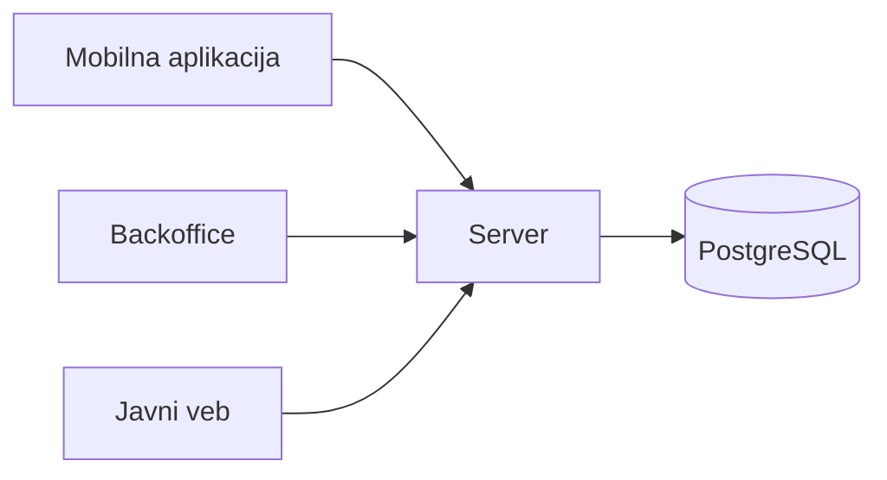

# Reboot – servis računara

Sistem za prijem i praćenje popravki računara u servisu. Klijenti preko mobilne aplikacije prijavljuju uređaj za popravku, prate radni nalog kroz dijagnostiku i popravku i odobravaju ponudu, i kada nemaju signal. Serviseri i šef servisa u backoffice aplikaciji preuzimaju naloge, prave ponude i vode stanje rezervnih delova, a javni veb prikazuje cenovnik, usluge i radno vreme servisa.

## Tim

| Ime i prezime | Broj indeksa | GitHub nalog |
| --- | --- | --- |
| Vojin Prljević | SI 74/24 | [VPrljevic](https://github.com/VPrljevic) |

Projekat radim samostalno.

## Zahtevi za temu

1. **Uloge.** Klijent vidi i menja samo svoje radne naloge (prijava uređaja, odgovor na ponudu). Serviser vidi sve naloge, preuzima ih i menja im stanje, a šef servisa uz to dodeljuje naloge serviserima i vodi stanje rezervnih delova.
2. **Stanja.** Glavni pojam je radni nalog, koji prolazi kroz stanja: primljen, dijagnostika, čeka odobrenje, u popravci, spreman za preuzimanje i preuzet. Nalog može da završi i kao otkazan ili kao odbijena ponuda.
3. **Pravila.** Klijent mora da odgovori na ponudu u roku od 48 sati, a serviser može imati najviše 5 aktivnih naloga. Dva servisera ne mogu istovremeno preuzeti isti nalog niti rezervisati poslednji komad istog dela sa stanja; o tome konačno odlučuje server, jer zavisi od podataka drugih korisnika.
4. **Rad bez mreže.** Klijent može da odobri ili odbije ponudu bez signala, a odluka se šalje serveru kada se veza vrati. Ako ponuda u međuvremenu istekne, server odbija zakasnelu odluku i klijent to vidi u aplikaciji.
5. **Posao za osoblje.** Osoblje radi sa svim nalozima servisa odjednom: tabla naloga po fazama, dodela servisera i pregled stanja delova, što zahteva veći ekran.
6. **Javni sadržaj.** Cenovnik usluga, vrste uređaja koje servis popravlja i radno vreme dostupni su svima bez prijave i imaju smisla za pretraživače.

## Delovi sistema

| Deo | Korisnici | Tehnologija | Platforme |
| --- | --- | --- | --- |
| Mobilna aplikacija | klijenti | Flutter | Android, iOS |
| Backoffice | serviseri, šef servisa | Flutter | Windows, macOS, Linux, veb |
| Javni veb | svi, pretraživači | Jaspr | veb |
| Server | svi klijenti sistema | Dart, Relic | Linux (Docker) |
| Domenski paket | svi delovi | Dart | sve |

## Stanje projekta

Detaljan opis domena i kôd dodaju se tokom semestra, po kontrolnim tačkama.
